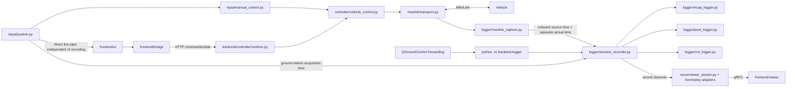

# Architecture

Mission Control runs one Rust frontend process and one Python backend process.
The frontend owns the native window and custom controls. The backend owns the
vehicle connection, mission execution, gamepad reader, and manual-control loop.
Rerun handles visualization and replay using data produced by the Python SDK.

## The command bridge

`backend/launch.py` starts the Rust frontend, passing the Python interpreter and
checkout path through environment variables. `frontend/main.rs` creates the
Rerun receiver. `frontend/bridge/worker.rs` starts `python -m backend.bridge`
with that receiver's URL and keeps the child's stdin open.

The Python bridge first prints one readiness JSON record containing the command
server's ephemeral loopback port, a random bearer token, and basemap metadata.
The Rust worker reads that record and uses `frontend/bridge/http.rs` for API
requests. After readiness, a separate nonblocking writer pushes small joystick
snapshots on stdout at up to 120 Hz. Native display stores only the newest one.
`frontend/bridge/protocol.rs` defines the in-process Rust messages
between the UI and the worker; HTTP payloads are JSON and are validated by
`backend/bridge/validation.py`.

| Endpoint | Responsibility |
| --- | --- |
| `GET /state` | Current live vehicle/controller state; renews the UI lease |
| `POST /command` | Arm/disarm, modes, joystick enable/pause, stop, mission edits/start, MCAP loading/filtering |
| `POST /prepare-quit` | Pause manual input and check confirmed armed state |
| `POST /shutdown` | Recheck arming and authorize graceful backend shutdown |
| `GET /tiles/...` | Authenticated imagery access retained from the copied backend |

The Python side separates **transport** (`http_server.py`) from **controller
ownership and safety** (`controller/runtime.py`). `bridge/runtime.py` composes
that controller runtime with the Rerun adapters and recording operations.

## The visualization bridge

The data connection is separate from the command API:

- `backend/rerun/live.py` converts live snapshots into Rerun entities.
- `backend/rerun/replay.py` converts MCAP files and selected reading layers.
- `backend/rerun/blueprint.py` describes the default layout and view queries.
- `frontend/viewer.rs` creates the native Rerun viewer that renders those logs.
- `frontend/ui/` draws the additional egui control panels beside that viewer.

The Python Rerun SDK adapters are visualization data producers. They contain no
Rust/egui widgets. The Rust UI contains no MAVLink implementation.

## FIU geographic basemap

The single FIU view is a geographic Rerun MapView. `backend/mapping/georeference.py`
reads WGS84 CRS, pixel scale, raster tiepoint, and valid-coverage metadata from
the packaged TIFF/GeoJSON files. `tiles.py` reprojects source pixels using
Web Mercator row latitudes and exposes authenticated `/tiles/fiu/{z}/{x}/{y}.png`.

At backend readiness, `frontend/app.rs` configures the local provider in the
pinned `frontend/vendor/re_view_map/` adaptation. It retains Rerun's geographic
visualizers and time-range behavior while replacing the fixed online tile
sources. The provider has no external map fallback. Bounds and center originate
from the imagery metadata; the current GPS/lake entities supply the map span.

Live and replay adapters log GPS as `GeoPoints` and paths as `GeoLineStrings`
under `/geo`. There are no duplicate `Points2D` overlay entities. Route controls and waypoint editing are embedded in this same geographic map.
The map supplies its projector for click/drag latitude and longitude conversion;
there is no second preview map. Replay recordings disable route editing.

## Safety and lifecycle ownership

`frontend/app.rs` handles UI focus, frame heartbeats, confirmations, and window
close events. The bridge worker observes a shared frame timestamp and expires
stalled UI input. A separate stdout pipe reader replaces the latest joystick
snapshot independently of HTTP requests and Rerun. `backend/controller/runtime.py` owns the backend input lease and command
locks; `backend/input/manual_control.py` keeps MAVLink manual output at 20 Hz independently of
rendering.

The Rerun logging observer calls `state(refresh_ui=False)` and cannot keep a
manual-input lease alive. Replay data never issues vehicle commands. Backend
stdin EOF triggers cleanup when the frontend disappears. Normal shutdown
checks armed state and sends neutral output before transport/logger teardown.

The header shows **CODE MODE** while an SDK controller owns the vehicle, with a
progress banner for routes, timed moves, and input profiles. Open-ended controls
and feedback-driven transfers show activity and elapsed time without estimating
a completion percentage. Replay retains its own label; code activity is still
visible in the separate banner.

**KILL SWITCH** (or Escape) latches a backend interlock, revokes SDK ownership,
pauses joystick input, and stops simulated missions. The backend sends five
MANUAL mode requests and neutral control pairs, using reported RC trims when
available. Nonzero manual/SDK output, arming, and new mission starts are blocked
until **Reset kill switch** is confirmed. Reset waits for pending mission and
stop workers and leaves controls idle. This is a software stop over the existing
vehicle link; sending commands does not confirm that the boat stopped. Live
heartbeat mode/arming telemetry remains authoritative.

## Where to change something

| Change | Start here |
| --- | --- |
| Vehicle controls / arming widgets | `frontend/ui/vehicle.rs` |
| Waypoint editor / lake controls | `frontend/ui/map_controls.rs` |
| MCAP picker / filter widgets | `frontend/ui/recordings.rs` |
| Panel placement / confirmations | `frontend/ui/layout.rs` |
| Input enable / app lifecycle | `frontend/app.rs` |
| Rerun host settings | `frontend/viewer.rs` |
| Default Rerun views | `backend/rerun/blueprint.py` |
| Telemetry fields / recorded entities | `backend/rerun/live.py`, `replay.py` |
| Vehicle commands / mission execution | `backend/controller/vehicle_control.py`, `mission_session.py` |
| Input expiry / resource cleanup | `backend/controller/runtime.py` |
| API routes / command validation | `backend/bridge/http_server.py`, `validation.py` |
| Native HTTP client / child management | `frontend/bridge/http.rs`, `worker.rs` |
| Map projection / imagery / lake geometry | `backend/mapping/` |
| File writers / recorder CLI / source clocks | `backend/logger/` |
| MAVLink connection / capture attachment / decoding | `backend/mavlink/` |
| Joystick acquisition / manual-control stream | `backend/input/` |
| MCAP replay decoding | `backend/recordings/` |

## Verification

Run `uv run python -m unittest discover -s tests -v` and
`cargo check --manifest-path frontend/Cargo.toml --locked` after changes to the
bridge or controller. The integration suite checks authenticated commands,
manual expiry, mission behavior, offline imagery, MCAP conversion, real Rerun
streaming, and parent-death cleanup without using a live vehicle.

## Generated files

Output defaults to `logs/<session>/` beneath the Mission Control checkout.
Each live session stores matching `.mcap`, `.rrd`, and `.jsonl` files in that
folder. The MCAP and JSONL share the same clock-aware record payloads. Incoming MAVLink
records use onboard boot/Unix time when present; local input uses GCS time. Missing
onboard time remains unavailable. Arrival time is separate and indexes MCAP. The RRD has its own disk stream, independent of the viewer's gRPC
stream, with a matching recording ID for visualization.

Active files use `.part` suffixes. Shutdown stops producers, writes the MCAP
indexes/footer and RRD footer, flushes/syncs files, then atomically publishes
completed filenames. EOF and graceful termination signals use the same cleanup.
Unfinished files retain their `.part` names after an abrupt termination.
Replay and filtered exports each receive a separate session folder under `logs`.

The root is resolved at runtime (`MISSION_CONTROL_DATA_DIR`, with
`MISSION_CONTROL_LOG_DIR` or legacy `HERON_LOG_DIR` overriding the log root).
Native Save dialogs use the standard file-dialog behavior. Generated output
no longer needs separate `recordings` or `blueprints` folders.

## Standalone recorder

`uv run mission-recorder --connection udpin:127.0.0.1:14560` captures QGC-forwarded
vehicle telemetry into three files without any controller or UI. Each writer can
also be used independently. The recorder does not send vehicle commands. Close
drains pending records, flushes writers, and finalizes every selected file.
See [logger APIs, clock domains, and QGC setup](../backend/logger/README.md).
